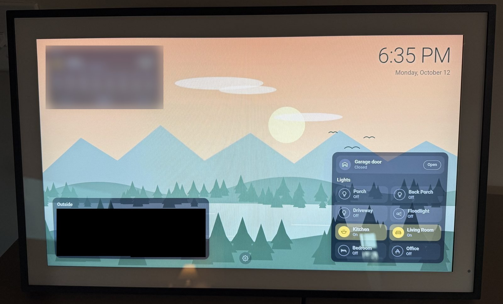

# LOOFII C-3 21.5" digital calendar (Allwinner A133, Android 10 → Android 12.1 GSI)

A record of **one unit**. Frames sold under the same name can use different boards and firmware.
Check every identity value below before running anything from `scripts/a133/`.

**Tested on:** one unit, from a Mac (Apple silicon, macOS) over USB-C and then Wi-Fi ADB. Everything marked as
done below was done on that unit; "probably" and "not attempted" mark guesses.

## Hardware and identity

| | Value seen on this unit |
|---|---|
| SoC | Allwinner **A133** (`ro.board.platform`/`ro.boot.hardware` = `sun50iw10p1`), 4× Cortex-A53 up to 1.512 GHz |
| GPU | PowerVR **GE8300** (`pvrsrvkm`), GLES 3.2 |
| RAM / storage | 2 GB / 32 GB eMMC (`mmcblk0` = 31,029,460,992 bytes) |
| Display | 21.5" 1920×1080 **dual-link LVDS** (no bridge chip; an IT6151 node in the device tree is not fitted), panel mounted rotated |
| Touch | HID-over-I²C `2575:0001`, 5 points |
| Wi-Fi / BT | AIC8800 (SDIO), 1×1. Associates as **802.11ac (VHT)** on this 4.9 kernel even though the chip is sold as Wi-Fi 6 |
| Sensors | Mi3da accelerometer, pt3r850 ambient light (small milky window bottom-right of the mat) |
| Power | **12 V ⎓ 3 A** barrel, 4.0×1.7 mm, centre positive. The USB-C port is device mode (ADB) and its 5 V input can't run the panel |
| Buttons | power, volume rocker, **reset pinhole (used for FEL)**. No microSD slot |
| Software (stock) | Android 10, `eng`/userdebug-style build, kernel 4.9.170 arm64, **userspace 32-bit only** → GSI type `arm32_binder64`; Treble, VNDK 29, dynamic partitions, not A/B; U-Boot 2018.05 |
| USB IDs | U-Boot fastboot **`1f3a:1010`**; BROM FEL **`1f3a:efe8`** |

Things the board has footprints/drivers for but this SKU does **not** have: presence/PIR sensor (driver `bl_h18l232b`,
GPIO PL10 floats and reads "present" forever; `ro.fullja.human_sensor=0`), RTC driver (clock resets until NTP),
hardware watchdog driver, camera.

## 1. ADB and root (stock)
ADB was available over USB; the stock build runs a **root adbd with permissive SELinux**, and the platform is signed with the
**public AOSP test keys**. Treat the stock image as having no security at all.

## 2. Vendor software worth knowing about (stock)
- Launcher/calendar app (`com.fujia.calendar`, system UID): analytics/ads SDKs, WebSocket + MQTT, license checks.
- **FOTA agent (`com.waophoto.fota`, system UID) with INSTALL_PACKAGES/RECOVERY over plain HTTP**: remote code execution as
  system if anyone can MITM it. Several factory test apps with INSTALL/MASTER_CLEAR/CAMERA/RECORD_AUDIO.
- `awlog` services write logcat/kmsg to shared storage.
Don't let the stock image online if you can avoid it.

## 3. Backup (do this before anything else)
Full eMMC over root ADB (`dd if=/dev/block/mmcblk0`), plus per-partition dumps. Verify: exact byte count, SHA-256 of the
whole image, the first 1 MiB matching independent reads, and each partition's on-device hash equal to its byte range in the image.
Partition layout seen: `bootloader` (FAT boot resources: logos, fonts), `env`, `boot`, `super`, `misc`, `recovery`, `cache`,
`vbmeta*`, `metadata`, `private`, `frp`, `empty`, `dtbo`, `media_data`, `UDISK` (= /data). boot0/U-Boot live before p1.

## 4. Recovery ladder (all proven on this unit)
1. **ADB** (USB, or LAN once set up).
2. **U-Boot fastboot**: `adb reboot bootloader` → `1f3a:1010`. macOS `fastboot` hangs talking to it; `scripts/a133/fb.py`
   (getvar/reboot) and `fbflash.py` (flash with an explicit allow-variable) use pyusb and work. The U-Boot fastboot
   **does not bounds-check sparse images**, so validate every sparse piece before sending it (`validate_pieces.py`).
3. **FEL (BROM, independent of the eMMC contents)**: unplug power **and** USB-C (USB back-powers the board), hold the reset
   pinhole, plug in, release after 3–5 s → black screen, `1f3a:efe8`. `sunxi-fel version` reports `soc=00001855(A133)`.
   From FEL you can reach U-Boot fastboot without Android: write `0x5F` to the RTC general-purpose register `0x07000118`
   (U-Boot's "boot to fastboot" flag) and trigger a watchdog reset (`scripts/a133/a133-flash.sh fel-to-uboot`). Release the pinhole first.
4. The recovery partition (eng, root adbd, fastbootd) exists, but on this unit "reboot recovery" dropped USB with no ADB, so it
   wasn't useful.

## 5. Replacing Android: phh AOSP 12.1 GSI on the factory vendor/kernel
Keep the factory **U-Boot, kernel, vendor and dtbo**; replace only the `system` logical partition inside `super`.
- Image: phh AOSP 12.1 **v416 `system-squeak-arm32_binder64-ab-vanilla`** from the official release,
  <https://github.com/phhusson/treble_experimentations/releases/tag/v416>.
  `system-squeak-arm32_binder64-ab-vanilla.img.xz`: 479,058,056 B, sha256
  `99491450941338287e7f2f2d5e4ad70da075f2421c97096fa625013092480074`.
  Decompressed `.img`: 1,309,229,056 B, sha256 `62b68f4c8f7e01497e02628f05e2a5ec0a0328ef98c8262be143c3ee90f2bc1b`.
- DSU (dynamic system update) also worked for a trial boot of a TrebleDroid Android 15 GSI without touching `system`.
- **Build `super` offline** from the factory `super` dump: replace the `system` extents, keep `vendor`/`product` byte-identical,
  rewrite LP metadata (`liblp.py`, `build_super.py`), then check with `validate_super.py` (geometry, metadata copies, extents, hashes).
- **Flash in independent sparse pieces** (`mksparse.py`): each piece covers the whole partition, RAW for its range and DONT_CARE
  elsewhere, so only pieces that changed need to be sent. RAW + DONT_CARE only (FILL untested). Verify
  `sha256(/dev/block/by-name/super)` on the device after boot against the built image.
- First boot: ~45-75 s; `/data` is formatted by the GSI if it was wiped (zeroing the head of UDISK is enough).
- **Rollback to stock:** flash the factory `super` + `metadata` and wipe the head of UDISK (`a133-flash.sh rollback`,
  then `verify-factory` compares the partition hash with your backup). **Not run on this unit**: the factory pieces were built and validated, and the same piece-flashing method was used several times between GSI builds, but the full return to stock was never needed.
- `fbflash.py` refuses to send a piece unless its sparse header matches the exact partition size you pass in
  (`FB_PART_BYTES`) and uses only RAW/DONT_CARE chunks. That check was added while preparing these scripts for sharing;
  the flashing on this unit was done with the same pieces after `validate_pieces.py` had checked them.

### Fixes the GSI needed (all done by patching files inside the ext4 image offline, no rebuild)
`ext4_rewrite_small.py` (rewrite a ≤4096-byte file in its own block) and `ext4_append.py` (append into the last block's slack)
keep the image layout identical, so `super` changes in only a few pieces. Check with `e2fsck -fn` afterwards.
- **Touch/display rotation:** stock combined a vendor-patched InputFlinger prop with SurfaceFlinger `ORIENTATION_180`;
  the GSI has no touch patch, so touch came out rotated. On this panel/digitizer the working combination was
  `ro.surface_flinger.primary_display_orientation=ORIENTATION_270` (in `/system/product/etc/build.prop`, which loads last) plus
  `settings put system user_rotation 3` and accelerometer rotation off. Verify with Pointer location in all four corners.
- **Sensors ("No sensors on the device"):** the vendor sensors HAL was never tested with SELinux enforcing. Appending the rules
  in `templates/sensors-sepolicy.cil` to `/system/system_ext/etc/selinux/system_ext_sepolicy.cil` fixed it (test-compile on the
  device with init's `secilc` arguments first). Accelerometer + light sensor then work with SELinux **enforcing**.
- **Boot chime:** it's the "charging started" sound (the frame is always on power): `charging_sounds_enabled=0`, `power_sounds_enabled=0`.
- `/system/bin/phh-on-boot.sh` (runs at boot_completed as root) is a convenient place for kiosk defaults and the firewall;
  `phh-on-data.sh` runs earlier (before netd: don't put firewall rules there).

### Hardening
- `ro.adb.secure=1` (GSI disables ADB auth by default) and restore your own key at boot (`templates/adb-key-restore.sh`).
- `pm disable me.phh.superuser` so apps can't request root; `adb root` still works for you.
- **Firewall in both directions** from the boot script (`templates/firewall.sh`): inbound only loopback + your LAN; outbound only
  loopback, LAN, multicast/broadcast and NTP. Useful when the router can't do per-device outbound rules. The only thing the
  GSI tried to reach was its OTA checker.
- `settings put global captive_portal_mode 0`; turn Bluetooth off if unused.

### WebView
The GSI ships WebView 95. The device's platform key is the **public AOSP testkey**, so a current LineageOS prebuilt
re-signed with the AOSP testkey installs as a normal system-app update:
- Source: <https://github.com/LineageOS/android_external_chromium-webview_prebuilt_arm> at commit
  `170e8996e41ef542769b5479297ab91072b487e2` ("Update Chromium Webview arm to 155.0.8059.39"), file `webview.apk`
  (Git LFS). sha256 `e744cd81ea83cfa6bda3da471ce58a5d9eac5d32260ad0ef98b8c9f49348f20e`. `com.android.webview`
  155.0.8059.39, minSdk 29, armeabi-v7a.
- Re-sign with the testkey from AOSP `build/target/product/security/` (`testkey.pk8` / `testkey.x509.pem`) using
  `apksigner` from the Android build-tools, then `adb install -r`. Undo: `adb shell pm uninstall-system-updates com.android.webview`. Chromium 155 then gives MSE/WebCodecs, hardware H.264/HEVC decode (Allwinner `OMX.allwinner.video.decoder.*`), WebRTC.

## 6. Kiosk notes (custom WebView app, same idea as `dashboard/kiosk/`)
- **With the display off, Android disables the touchscreen**, so touch-to-wake from display-off is impossible here. Keep the
  display on and use a black overlay at minimum backlight for "off" (backlight floor ≈ 23 % through the framework tables).
- The ambient light sensor works well as a "room is in use" signal (room lit ≈ 110-130 lux, dark ≈ 2 lux).
- Retry the page load on error (Wi-Fi/server may come up after the kiosk at boot).

## 7. Display, boot screen, thermals
- Stock panel timing runs at **56.6 Hz** (135 MHz pixel clock, ht 2108 × vt 1132). An overlay in the `dtbo` partition entry the
  bootloader applies (`dtbo_type 3` on this unit) with `lcd0 { lcd_dclk_freq = <143>; }` gives **59.93 Hz**; the panel accepted
  it. Thermal cost vs 56.6 Hz was within noise (≈1 °C).
- The bootloader shows `bootlogo.bmp` from the FAT `bootloader` partition (24-bit 1920×1080 BMP, displayed **rotated 180°**
  relative to how it's stored). The moving "WELCOME" was the stock Android `/system/media/bootanimation.zip`, which the GSI doesn't have.
- Thermals (sealed, fanless): ~47 °C display off, ~57 °C display on with a static page, ~60 °C with a light dashboard.
  **Most idle heat is the display pipeline, not the CPU** (capping the CPU changed nothing; the GPU devfreq never scales, fixed 504 MHz).
  Two simultaneous live videos in WebView pushed it to 97-99 °C with throttling; one live stream ≈ 77 °C; snapshots ≈ idle.
  Design dashboards around **snapshot tiles + at most one live stream**.

## What did not work / open
- Wi-Fi 6 (HE) isn't negotiated on the 4.9 kernel; a kernel change would mean porting vendor drivers (GPU module must match
  the vendor userspace). Not attempted.
- No PIR/presence sensor on this SKU despite the driver and DT node.
